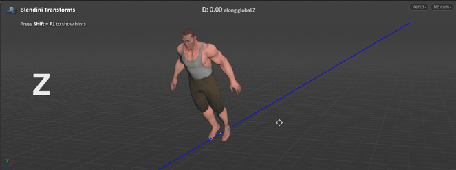

### Houdini package to transform objects with G R S shortcuts. Like in Blender.

- Works natively on all nodes without an HDA
- Transform along any axis, in world or local space
- Enter exact values using numbers and math expressions
- Move and rotate items in the Network Editor

## Installation

1. Download the latest release ZIP from the [Releases page](https://github.com/yonatanbary/blendini-transforms/releases).
2. Extract the archive.
3. Move **`BlendiniTransforms.json`** and the **`Blendini Transforms`** folder into your Houdini `packages` directory:
   - **Windows:** `C:\Users\<username>\Documents\houdini21.0\packages`
   - **macOS:** `~/Library/Preferences/houdini/21.0/packages`

   Replace `21.0` with your Houdini version. Create the `packages` folder if it doesn't exist.
4. Restart Houdini.

## Usage
### Transform Modes

Press `G` to grab (move), `R` to rotate, or `S` to scale.

## Custom Nodes

To add custom nodes that work with Blendini Transforms, append them to `Blendini Transforms/Nodes.txt`.

Use the format `category/node_name`, one per line (e.g. `sop/paradigm_sourceShape::1.0`).

The node must have standard `t`, `r`, or `s` parameters for the transform shortcuts to work.
